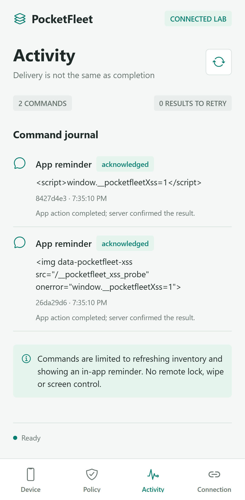

# UEM и безопасность: что проверяет PocketFleet

В UEM важен не только список устройств: нужно понимать, кому принадлежит команда, какую версию политики применяет клиент и что означает подтверждение после сетевого сбоя. PocketFleet позволяет разобрать эти вопросы на небольшом учебном клиенте Android/iOS и API. Он управляет только собственной сессией приложения, а не операционной системой.

Этот материал помогает изучить и объяснить реализованное. Проект создан с помощью AI; перед интервью запусти тесты, открой указанные места в коде и воспроизведи один сбой самостоятельно. Не выдавай учебный проект за коммерческий опыт или проверку настоящей MDM-инфраструктуры.

## Запуск проверок

Из каталога проекта, Node.js 22.19+:

```sh
npm ci
npm run check
npm run test:security
npx playwright install chromium
npm run test:browser:security
```

`check` включает TypeScript, ESLint и все 88 Vitest-тестов. `test:security` запускает только 30 новых проверок API, протокола и восстановления. Playwright отдельно выполняет два сценария в двух конфигурациях Chromium: desktop и mobile viewport. Это четыре браузерных прогона, без эмулятора Android, настоящего iPhone и Safari.

Браузерный тест поднимает одноразовый API на `127.0.0.1:4349` и запускает/использует PocketFleet web preview на `127.0.0.1:8087`. Ключ из `tests/e2e/lab.ts` намеренно публичный и предназначен только для этого тестового сервера с новой временной базой. Не используй его для обычного API. Результаты и скриншоты сохраняются в `test-results/`; в GitHub Actions они доступны как `browser-security-results`. Токены не выводятся в отчёт; сетевые trace-файлы отключены.

## Модель угроз и проверяемые границы

Предполагается один доверенный администратор локального стенда. Сеть может терять ответы; устройство может отправлять ложные данные или чужие ID; браузер может открыть посторонний сайт; текст напоминания считается недоверенным для HTML-рендеринга. Компрометация компьютера администратора, rooted/jailbroken телефон и полный контроль над сервером выходят за эти гарантии.

| Риск                                                               | Проверка и ожидаемый результат                                                                           | Где смотреть                                          |
| ------------------------------------------------------------------ | -------------------------------------------------------------------------------------------------------- | ----------------------------------------------------- |
| Токен устройства используется как администраторский                | Пять маршрутов возвращают 401; устройства, политика и очередь остаются прежними                          | `tests/security-api.test.ts`                          |
| Устройство A подтверждает команду устройства B (BOLA)              | 404 без раскрытия чужого сообщения; состояние команды B не меняется                                      | `tests/security-api.test.ts`, `server/store.ts`       |
| Подмена deviceId или готового compliance-вердикта в инвентаризации | Строгий контракт отклоняет поля, данные устройств не меняются; сервер выводит владельца из токена        | `tests/security-api.test.ts`, `shared/contracts.ts`   |
| Запись из постороннего browser Origin                              | 403 до изменения состояния даже при наличии bearer; `null` и домен-двойник тоже отклоняются              | `tests/security-api.test.ts`, `server/app.ts`         |
| Попытка авторизации через cookie или query                         | 401; явный Authorization обязателен на защищённых маршрутах                                              | `tests/security-api.test.ts`                          |
| Кэширование токена / утечка деталей ошибки                         | JSON с `no-store`, `nosniff`, CSP; 500 без stack trace и токена                                          | `tests/security-api.test.ts`                          |
| Клиент получает чужой snapshot/команду или дубликаты ID            | Останавливается до сохранения ответа и выполнения команды                                                | `tests/security-protocol.test.ts`, `src/core/sync.ts` |
| Политика откатилась или поменялась без новой revision              | Ответ отклоняется, прежний кэш сохраняется; новая корректная revision принимается                        | `tests/security-protocol.test.ts`                     |
| ACK пришёл для другого ID, владельца или статуса                   | Pending result остаётся в outbox; синхронизация завершается ошибкой                                      | `tests/security-protocol.test.ts`                     |
| Сервер принял ACK, клиент потерял ответ и перезапустился           | Повтор подтверждения после чтения кэша/БД с диска; без повторного действия в этом окне сбоя              | `tests/uem-recovery.test.ts`                          |
| Сохранённый HTML/JavaScript попал в напоминание                    | Реальный браузер показывает текст; нет внедрённых узлов, исполнения маркера и запроса изображения        | `tests/e2e/browser-security.spec.ts`                  |
| Отозванный токен / сохранение web-токена                           | Следующая синхронизация получает отказ; токена нет в localStorage/sessionStorage; reload возвращает DEMO | `tests/e2e/browser-security.spec.ts`                  |

Дополнительно проверяются лимит тела запроса 16 KiB, параметризованный SQL на строке с SQL-синтаксисом и неизменность данных при повторе старого ACK. Уже существующие тесты покрывают сроки действия кодов/команд, очередь, отмену запросов, single-flight sync и состояния оценки политики.

## Кейс 1: сервер выполнил запрос, но клиент этого не знает

Тест `recovers a committed but lost ACK across SQLite reopen and client cache reload` использует настоящие Fastify-обработчики и SQLite-файл:

1. Сервер ставит `refresh_inventory` в очередь; клиент получает команду.
2. Клиент собирает инвентаризацию, сохраняет ID обработанной команды и результат в outbox **до отправки ACK**.
3. HTTP-обработчик принимает результат и фиксирует `acknowledged` в БД. Тест обрывает получение ответа после commit.
4. В базе уже успех, в клиентском файле ещё один pending result. Создаются новые экземпляры сервера, Store и SyncEngine; база заново открывается, кэш читается с диска.
5. Клиент повторяет ACK. Сервер возвращает прежний результат с первоначальным `completedAt`; outbox очищается. Счётчик сборов инвентаризации отличает повтор действия от обычного нового check-in.

Что рассказать после собственного разбора:

> «Я проверял не только отсутствие сети до запроса, но и неоднозначный результат: сервер сохранил ACK, а клиент не получил ответ. Для этого сделал интеграционный тест с SQLite на диске и загрузкой клиентского кэша в новый экземпляр синхронизатора. Повтор отправки результата идемпотентен, а outbox помогает не выполнять команду заново в этом сценарии».

Вероятное уточнение: **«Это exactly-once?»** Нет. Доставка at-least-once. Сбой между действием и сохранением его результата может привести к повтору действия. Поэтому здесь только безопасные повторяемые операции; нельзя переносить эту схему на платежи или удаление данных без другого дизайна. Это также не тест настоящего убийства процесса телефона и не гарантия атомарности AsyncStorage при отключении питания.

## Кейс 2: UUID не заменяет проверку прав

Устройство A знает ID команды B и отправляет результат со своим действующим токеном. Сам факт, что токен корректен, ещё не разрешает менять чужой объект.

В `server/store.ts` поиск результата привязан одновременно к `commandId` **и** к `device_id`, полученному из аутентифицированного токена. Тест сравнивает ответ с несуществующей командой и проверяет отсутствие изменений в БД. Отдельно пять тестов показывают, что device-token не даёт прав администратора. Клиент дополнительно отклоняет чужой snapshot/команду, если сервер вернул противоречивый ответ.

Формулировка для обсуждения:

> «Я разделил аутентификацию и авторизацию на объект. Действующий токен говорит, какое это устройство; проверка владельца определяет, какую команду ему разрешено подтвердить. В негативном тесте важно проверить и HTTP-ответ, и то, что чужая команда осталась без изменений».

Вероятное уточнение: **«Можно ли доверять версии ОС из inventory?»** Нет: она заявлена клиентом. Контракт проверяет структуру, а не достоверность устройства. Это baseline assessment, не hardware attestation. Неизвестная версия и web-preview дают `unknown`, а не автоматическое соответствие политике.

## Кейс 3: XSS и CSRF решают разные проблемы

**XSS.** Администратор передаёт две безвредные контрольные строки: HTML с `onerror` и `<script>` с присваиванием тестового маркера. Они проходят через реальный API и SQLite в настоящий интерфейс. Playwright проверяет, что текст виден буквально, соответствующих HTML-узлов нет, маркер не появился и изображение не запрашивалось. Защита в этом пути — безопасный текстовый вывод через React Native Text. Введённый текст не «чистится» запретом символа `<`: он не должен интерпретироваться как разметка. Проверка одного JSON-ответа сама по себе XSS не проверяет.

Скриншот реального прогона мобильного Chromium (web): обе команды подтверждены, разметка остаётся видимым текстом. Автотест отдельно проверяет отсутствие выполнения кода; один скриншот этого не доказывает.



**CSRF.** Защищённые запросы используют явный bearer в Authorization; cookie/query-токены не принимаются. Добавлена проверка точного Origin для записывающих browser-запросов, включая DELETE; одного CORS недостаточно, потому что запрет читать ответ не обязательно предотвращает отправку запроса. При отсутствующем Origin native/CLI-клиенту всё равно нужен токен. Origin можно подделать вне браузера: это дополнительный барьер, а не замена аутентификации. Если ввести cookie-сессию, нужно заново продумать CSRF-токены, SameSite и серверные проверки.

Формулировка для обсуждения:

> «Для XSS я проверил место вывода данных в настоящем браузере. Для CSRF разобрал, как браузер передаёт полномочия: в проекте нет автоматической cookie-аутентификации. Дополнительно сервер запрещает изменения с постороннего Origin. Я не считаю CORS заменой авторизации и не выдаю API CSP за CSP всей веб-страницы».

Вероятные уточнения:

- **Спасает ли отсутствие localStorage от XSS?** Оно уменьшает долговременное хранение токена. Активный XSS всё ещё может выполнять действия в текущей странице и перехватывать доступные ей данные. Поэтому нужен безопасный вывод, а не только выбор хранилища.
- **Мгновенно ли отзыв отменит доставленную команду на offline-устройстве?** Нет. Сервер блокирует последующие авторизованные запросы; уже полученное действие нельзя отозвать задним числом. Здесь это безопасное напоминание/сбор ограниченной инвентаризации.
- **Достаточно ли проверки revision для защиты от злонамеренного сервера?** Нет. Она выявляет откат относительно имеющегося кэша и противоречия версии; сервер может прислать ложную более высокую revision. Нужны доверенный транспорт, иной threat model и при необходимости подписанные политики.
- **Гарантируют ли 88 + 4 прогона безопасность?** Нет. Это конкретные воспроизводимые регрессионные проверки. Они не покрывают все входы, браузеры, нативные API, производительность и все возможные уязвимости.

## Что спросить у UEM-команды

После рассказа о доставке команд: «Как у вас различаются принятие команды, доставка устройству и подтверждённое выполнение? Как обрабатываются потерянные подтверждения и долгий offline?»

После рассказа о политиках: «Как решаете конфликты и версии политик? Есть ли разные гарантии для управляемых устройств и личных устройств пользователя?»

Во время обсуждения фронтенда и тестов: «Какие границы особенно важны в ваших автотестах: права на устройство, устаревшие данные, большие парки устройств, совместимость платформ? С каких таких задач обычно начинает стажёр?»

Не обязательно задавать все три вопроса подряд. Выбери подходящий момент после соответствующего рассказа команды и свяжи вопрос с тем, что действительно разобрал в своём проекте.

## Границы и источники

Реальные Android/iPhone, Keychain/Keystore после перезапуска, нативный жизненный цикл и подписанные APK/IPA пока не проверены: см. [TESTING.md](TESTING.md). Известные ограничения SDK-зависимостей раскрыты в [SECURITY.md](../SECURITY.md). Не называй проект «без уязвимостей» или полноценным MDM.

- [OWASP: предотвращение XSS](https://cheatsheetseries.owasp.org/cheatsheets/Cross_Site_Scripting_Prevention_Cheat_Sheet.html)
- [OWASP: предотвращение CSRF](https://cheatsheetseries.owasp.org/cheatsheets/Cross-Site_Request_Forgery_Prevention_Cheat_Sheet.html)
- [OWASP API1: Broken Object Level Authorization](https://owasp.org/API-Security/editions/2023/en/0xa1-broken-object-level-authorization/)
- [Playwright: запуск тестовых серверов](https://playwright.dev/docs/test-webserver)
